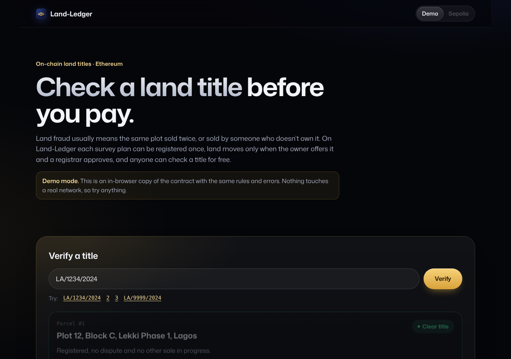

# Land-Ledger

**Check a land title before you pay.** An on-chain land title registry on Ethereum, with a free public check that any buyer can run.

Land fraud in Nigeria usually takes one of two forms: the same plot sold to several buyers, or land sold by someone who doesn't own it. Land-Ledger makes both impossible to hide:

- **One plan, one parcel.** The land bureau approves each survey plan, and a plan can be registered exactly once. A second registration on the same plan is refused by the contract.
- **Two keys to move land.** The owner offers the parcel to a buyer, then a registrar approves. Neither can move land alone, and only one sale can be open at a time.
- **Disputes freeze the title.** A registrar can flag a claim, and nothing moves until it is cleared.
- **No personal data on-chain.** Deeds stay off-chain. The ledger keeps only their hash, so a buyer can check that the papers they were handed match the registered ones. The file is hashed in the browser and never uploaded.



## Try it

The app has two modes:

- **Demo**: an in-browser copy of the contract with the same rules, errors and events. Switch between the bureau, a registrar, a landowner and a buyer and run the whole flow. No wallet needed.
- **Sepolia**: the real contract, deployed at [`0xbce3f1ea38642f75aeaba6bcdba4d88243fca911`](https://sepolia.etherscan.io/address/0xbce3f1ea38642f75aeaba6bcdba4d88243fca911). Verifying reads through a public node, so it needs no wallet either. Bureau, registrar and owner actions go through MetaMask.

## The contract

[`contracts/contracts/LandLedger.sol`](contracts/contracts/LandLedger.sol), Solidity 0.8.26.

| Role | Can do |
| --- | --- |
| Bureau (the deployer) | Appoint or remove registrars, approve survey plans |
| Registrar | Register a parcel on an approved plan, approve a sale, flag or clear a dispute |
| Owner | Offer their parcel to a buyer, withdraw the offer |
| Anyone | `verify(id)`: owner, disputed, sale pending, times sold |

Every change emits an event, so a title's full history is readable from the logs. Errors are custom errors (`PlanNotApproved`, `UnderDispute`, `TransferPending`, ...), which the app turns into plain sentences.

Survey plan numbers are stored as `keccak256` of a normal form (trimmed, spaces removed, upper case), so `la/1234/2024` and `LA/1234/2024` find the same plan.

## Tests

```bash
# contract: 18 Hardhat tests
cd contracts && npm install --legacy-peer-deps && npx hardhat test

# app: the demo chain follows the contract's rules, lookup, plan hashing
npm install && npm test
```

Both suites run in GitHub Actions on every push.

## Run the app

```bash
npm install
npm run dev
```

To point the Sepolia mode at your own deployment, set:

```
NEXT_PUBLIC_LANDLEDGER_ADDRESS=0x...
NEXT_PUBLIC_LANDLEDGER_DEPLOY_BLOCK=<block it was deployed in>
```

The app is a static export (`out/`), so it can be hosted anywhere.

## What changed from v1

v1 (kept in [`legacy-v1/`](legacy-v1)) was a Truffle project with two serious problems: `registrarReg` had no access check, so anyone could register themselves as a registrar, and it wrote family names, phone numbers and BVNs to the public chain. v2 is a rewrite: role checks on every action, no personal data on-chain, one registration per survey plan, two-step transfers, dispute freezes, custom errors, full tests, and a public verify page.

## Author

Samson Olakeye ([@SamOpera](https://github.com/SamOpera)), blockchain engineer, Economics + Computer Science. [samsonolakeye.com](https://samsonolakeye.com)

MIT licensed.
